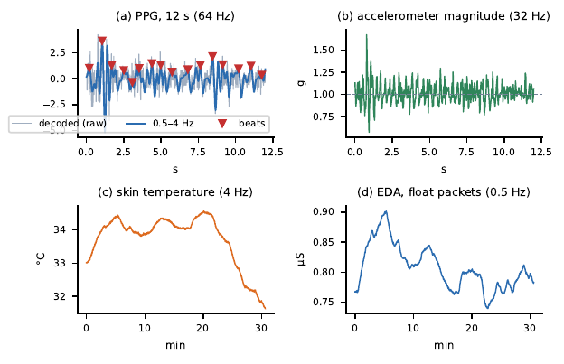

# Supplementary Material

*Physiological Stress Patterns in Urban Public Transport* — M. Cahuana-Nina, A. L. Cuela, R. V. Zavalaga Orozco. Companion to `paper/main.tex`; section numbers S1–S9 and Tables/Fig. S1 are those cited in the paper. Participants are P1–P4; sessions are labelled Pk-j (j-th session of participant k in chronological order; P2-1 and P2-2 are the legacy-format sessions).

This document accompanies the main paper. Every number below is generated by the scripts in the shared code package from the files in `salida/`. BA = balanced accuracy (chance = 0.33 for three classes); LOPO = leave-one-participant-out; LOSO = leave-one-session-out. Participants are P1–P4; P1 and P4 shared one wristband.

## S1. Implementation details

**Table S1.** Preprocessing, features, models and statistical settings (all random seeds are 0).

| Component | Setting |
|:---|:---|
| Clock reconstruction | Counter unwrapped with arrival-time prior; sample time $`=a+b s`$ from a robust (two-pass, $`3\sigma`$) linear fit of arrival time against sample index; nominal rate used if the fitted rate deviates by $`>2\%`$. |
| PPG | Zero-phase Butterworth band-pass, order 3, 0.5–8 Hz for window features and 0.5–4 Hz for beat detection, computed on the window padded by 5 s per side. Idle-pattern samples removed. Beats: peak detection with minimum separation $`\max(0.33 \mathrm{s}, 0.6/f_0)`$, prominence 0.3 SD; inter-beat intervals valid if 0.4–1.5 s and within $`\pm30\%`$ of the median; at least 15 valid intervals for HR/SDNN, 10 successive pairs for RMSSD. |
| Spectral HR and quality | Hann window, 4$`\times`$ zero padding, peak in 0.7–3.0 Hz; quality index = power within $`\pm0.2`$ Hz of $`f_0`$ and $`\pm0.3`$ Hz of $`2f_0`$ over the 0.5–8 Hz power. A window has valid HR if peak and spectral HR differ by $`\le10`$ bpm. |
| Coverage thresholds | PPG and ACC $`\ge80\%`$ of expected samples; temperature $`\ge50\%`$; EDA (float packets) $`\ge1/3`$. |
| Accelerometer | Magnitude of $`(x,y,z)`$; Welch spectrum, 4-s segments (128 samples at 32 Hz); log band powers 0.3–1, 1–3, 3–6, 6–10, 10–16 Hz and per-axis log SD. |
| Transformations | $`\ln`$ of RMSSD, SDNN, accelerometer SD and EDA; $`z`$-score within participant; clipping at $`\pm5`$ SD. EDA windows start $`\ge300`$ s after the first EDA packet of the session. |
| Noise | Leq $`=10\log_{10}\overline{10^{L/10}}`$ over valid seconds; $`-120`$ dBFS treated as missing. |
| K-Means | $`k=2`$–6, 10 initialisations. GMM: full covariance, 3 initialisations. Ward linkage. DBSCAN: $`\varepsilon\in\{0.8,1.0,1.3,1.6\}`$, min. samples $`\in\{10,20\}`$. |
| Random forest | 100 trees, min. leaf size 5, balanced class weights. Logistic regression: L2, $`C=1`$, balanced weights, 2000 iterations. |
| Mixed models | statsmodels `MixedLM`, REML, random intercept per session, non-overlapping windows (every second window of each bus segment). |
| Uncertainty | 95% CIs from 2000 bootstrap resamples of whole sessions. Permutation tests: labels shifted circularly within each (session, bus-segment) block (preserves autocorrelation); 200 permutations for classifier cells, 1000 for the vibration cells, 2000 for H2, 500 for H1 (noise series shifted within session), 2000 for cluster NMI. |
| Multiple tests | Holm–Bonferroni. Family 1 (confirmatory): H1, H2 and the six physiology-only classifier cells. Family 2 (exploratory): the three vibration cells. |
| Software | Python 3.13.9, NumPy 2.3.5, pandas 2.3.3, SciPy 1.16.3, scikit-learn 1.7.2, statsmodels 0.14.5, matplotlib 3.10.6, pyarrow 21.0.0. |

## S2. Cross-person classifiers: full results

**Table S2.** Random forest, LOPO. Null = block-permutation distribution of BA. Holm-adjusted $`p`$ is given for the confirmatory family (with H1 and H2); $`p`$ of the three vibration cells uses 1000 permutations, the rest 200.

| An. | Features | Target | $`n`$ | BA | 95% CI | F1 | Null mean | Null p95 | $`p`$ | $`p_\mathrm{Holm}`$ |
|:---|:---|:---|:---|---:|:--:|:--:|:--:|:--:|---:|---:|
| A | physiology | Traffic | 1054 | 0.299 | \[0.238, 0.363\] | 0.299 | 0.302 | 0.341 | .53 | 1.00 |
| A | physiology | Noise | 709 | 0.338 | \[0.302, 0.367\] | 0.331 | 0.336 | 0.373 | .48 | 1.00 |
| A | physiology | Exposure | 634 | 0.242 | \[0.186, 0.287\] | 0.241 | 0.279 | 0.324 | .94 | 1.00 |
| A | physiology + vibration | Traffic | 1054 | 0.435 | \[0.350, 0.514\] | 0.438 | 0.320 | 0.372 | .001 | – |
| A | physiology + vibration | Noise | 709 | 0.411 | \[0.346, 0.470\] | 0.396 | 0.334 | 0.376 | .003 | – |
| A | physiology + vibration | Exposure | 634 | 0.254 | \[0.217, 0.290\] | 0.251 | 0.283 | 0.325 | .90 | – |
| A | movement-residual physiology | Traffic | 1054 | 0.312 | \[0.235, 0.384\] | 0.310 | 0.307 | 0.355 | .41 | – |
| A | movement-residual physiology | Noise | 709 | 0.319 | \[0.270, 0.356\] | 0.313 | 0.337 | 0.374 | .82 | – |
| A | movement-residual physiology | Exposure | 634 | 0.235 | \[0.185, 0.281\] | 0.234 | 0.296 | 0.329 | 1.00 | – |
| B | physiology + EDA | Traffic | 402 | 0.342 | \[0.261, 0.412\] | 0.340 | 0.317 | 0.378 | .25 | 1.00 |
| B | physiology + EDA | Noise | 411 | 0.381 | \[0.294, 0.425\] | 0.372 | 0.375 | 0.433 | .47 | 1.00 |
| B | physiology + EDA | Exposure | 398 | 0.205 | \[0.168, 0.272\] | 0.201 | 0.240 | 0.288 | .89 | 1.00 |
| B | physiology + EDA + vibration | Traffic | 402 | 0.420 | \[0.350, 0.503\] | 0.415 | 0.329 | 0.403 | .01 | – |
| B | physiology + EDA + vibration | Noise | 411 | 0.405 | \[0.323, 0.457\] | 0.396 | 0.375 | 0.439 | .25 | – |
| B | physiology + EDA + vibration | Exposure | 398 | 0.224 | \[0.180, 0.322\] | 0.223 | 0.242 | 0.291 | .73 | – |
| B | residual physiology + EDA | Traffic | 402 | 0.381 | \[0.314, 0.470\] | 0.378 | 0.332 | 0.390 | .09 | – |
| B | residual physiology + EDA | Noise | 411 | 0.336 | \[0.228, 0.388\] | 0.330 | 0.386 | 0.441 | .91 | – |
| B | residual physiology + EDA | Exposure | 398 | 0.213 | \[0.176, 0.322\] | 0.211 | 0.245 | 0.295 | .88 | – |

**Table S3.** Multiple-comparison control. Family 1: H1 primary, H2 and the six physiology-only classifier cells. Family 2 (exploratory): vibration cells.

| Test                                     | raw $`p`$ | Holm $`p`$ |
|:-----------------------------------------|----------:|-----------:|
| H1 (primaria)                            |       .34 |       1.00 |
| H2                                       | $`<`$.001 |       .004 |
| A-trafico                                |       .53 |       1.00 |
| A-ruido                                  |       .48 |       1.00 |
| A-exposicion                             |       .94 |       1.00 |
| B-trafico                                |       .25 |       1.00 |
| B-ruido                                  |       .47 |       1.00 |
| B-exposicion                             |       .89 |       1.00 |
| A: physiology + vibration, traffic       |      .001 |       .003 |
| A: physiology + vibration, noise         |      .003 |       .006 |
| B: physiology + EDA + vibration, traffic |       .01 |        .01 |

## S3. Breakdown by participant and session

**Table S4.** BA of the held-out participant (LOPO folds). “–” = participant not in the analysis.

| An. | Features                     | Target  |  P1  |  P2  |  P3  |  P4  |
|:----|:-----------------------------|:--------|:----:|:----:|:----:|:----:|
| A   | physiology                   | Noise   | 0.34 | 0.33 | 0.35 | 0.33 |
| A   | physiology                   | Traffic | 0.35 | 0.31 | 0.20 | 0.44 |
| A   | physiology + vibration       | Noise   | 0.43 | 0.44 | 0.38 | 0.35 |
| A   | physiology + vibration       | Traffic | 0.48 | 0.41 | 0.39 | 0.67 |
| B   | physiology + EDA             | Noise   | 0.41 |  –   | 0.33 | 0.46 |
| B   | physiology + EDA             | Traffic | 0.48 |  –   | 0.31 | 0.42 |
| B   | physiology + EDA + vibration | Noise   | 0.43 |  –   | 0.40 | 0.37 |
| B   | physiology + EDA + vibration | Traffic | 0.56 |  –   | 0.37 | 0.58 |

**Table S5.** Analysis A, traffic proxy: BA in each session (pooled LOPO predictions of that session’s windows).

| Session                       | $`n`$ | physiology | \+ vibration |
|:------------------------------|------:|:----------:|:------------:|
| P1-1, 09-26 09-28-01          |   122 |    0.11    |     0.52     |
| P1-2, 09-26 10-30-28          |    86 |    0.31    |     0.37     |
| P1-3, 09-26 17-15-09          |    20 |    0.42    |     0.18     |
| P2-3, 09-26 08-35-05          |    30 |    0.37    |     0.47     |
| P2-4, 09-26 09-27-48          |   116 |    0.36    |     0.49     |
| P2-5, 09-28 08-21-45          |    99 |    0.31    |     0.50     |
| P2-6, 09-28 13-24-09          |    82 |    0.45    |     0.67     |
| P2-7, 09-30 07-55-50          |    36 |    0.42    |     0.44     |
| P3-1, 09-26 08-29-43          |    28 |    0.20    |     0.33     |
| P3-2, 09-26 09-41-23          |    60 |    0.21    |     0.40     |
| P3-4, 09-28 08-45-50          |    76 |    0.28    |     0.52     |
| P4-1, 09-30 16-02-43          |    50 |    0.44    |     0.67     |
| P2-1 (legacy), 09-18 09-57-46 |    58 |    0.44    |     0.30     |
| P2-2 (legacy), 09-18 13-22-02 |   159 |    0.21    |     0.30     |

## S4. Confusion matrices

**Table S6.** Analysis A, traffic proxy, physiology: row-normalised confusion matrix (rows = true class, columns = predicted).

|               | congestionado | fluido | moderado | alto | bajo | medio | alta | baja | media |
|:--------------|:-------------:|:------:|:--------:|:----:|:----:|:-----:|:----:|:----:|:-----:|
| congestionado |     0.24      |  0.30  |   0.46   | nan  | nan  |  nan  | nan  | nan  |  nan  |
| fluido        |     0.28      |  0.40  |   0.32   | nan  | nan  |  nan  | nan  | nan  |  nan  |
| moderado      |     0.35      |  0.39  |   0.26   | nan  | nan  |  nan  | nan  | nan  |  nan  |

**Table S7.** Analysis A, traffic proxy, physiology + vibration: row-normalised confusion matrix (rows = true class, columns = predicted).

|               | congestionado | fluido | moderado | alto | bajo | medio | alta | baja | media |
|:--------------|:-------------:|:------:|:--------:|:----:|:----:|:-----:|:----:|:----:|:-----:|
| congestionado |     0.48      |  0.20  |   0.32   | nan  | nan  |  nan  | nan  | nan  |  nan  |
| fluido        |     0.21      |  0.51  |   0.28   | nan  | nan  |  nan  | nan  | nan  |  nan  |
| moderado      |     0.35      |  0.33  |   0.32   | nan  | nan  |  nan  | nan  | nan  |  nan  |

**Table S8.** H2, LOPO logistic regression at threshold 0.5 (counts). Error rate 23.2%; misses of stopped windows 26.9%, false alarms 20.0%.

|              | predicted moving | predicted stopped |
|:-------------|:----------------:|:-----------------:|
| true moving  |       403        |        101        |
| true stopped |       118        |        321        |

## S5. H2: accelerometer detector

**Table S9.** Feature-group ablation (LOPO AUC, logistic regression): group alone, and all features except the group.

| Group                  | AUC alone | AUC without |
|:-----------------------|:---------:|:-----------:|
| bandas 0.3-1 Hz        |   0.736   |    0.829    |
| 1-3 Hz                 |   0.812   |    0.838    |
| 3-6 Hz                 |   0.832   |    0.831    |
| 6-10 Hz                |   0.801   |    0.824    |
| 10-16 Hz               |   0.789   |    0.837    |
| desvío por eje (x,y,z) |   0.735   |    0.808    |
| desvío de la magnitud  |   0.837   |    0.821    |
| todas las features     |   0.826   |      –      |

**Table S10.** H2 error analysis. Error rate by fraction of the window spent stopped (GPS), by GPS accuracy, and in the four worst sessions.

| Stopped fraction              | $`n`$ |       error (%) |
|:------------------------------|------:|----------------:|
| \<0.1                         |   504 |            20.0 |
| 0.1-0.5                       |     3 |            33.3 |
| 0.5-0.7                       |    97 |            16.5 |
| 0.7-0.9                       |    90 |            18.9 |
| \>0.9                         |   249 |            33.7 |
| GPS accuracy                  | $`n`$ |       error (%) |
| \<=5 m                        |   482 |            21.2 |
| 5-10 m                        |   164 |            22.6 |
| \>10 m                        |   297 |            26.9 |
| Session (worst four)          | $`n`$ | error (%) / AUC |
| P2-1 (legacy), 09-18 09-57-46 |    58 |     48.3 / 0.46 |
| P2-7, 09-30 07-55-50          |    33 |     39.4 / 0.76 |
| P3-2, 09-26 09-41-23          |    51 |     33.3 / 0.87 |
| P1-1, 09-26 09-28-01          |   144 |     29.2 / 0.94 |

**Sensitivity to label selection and to wristband.** Restricting H2 to windows whose *bus* label was used as recorded (P2 sessions 1–3, P3, P4; $`n=358`$) gives LOPO AUC 0.876. AUC by wristband (LOPO predictions): wristband A (P1, P4) 0.81; B (P2) 0.83; C (P3) 0.91. **Speed regression (exploratory).** Random forest regression of mean GPS speed from the same features, LOPO: Spearman 0.49, $`R^2=0.12`$, MAE 6.9 km/h (8.5 km/h for the mean predictor); per participant Spearman 0.61, 0.41, 0.61, 0.73 (P1–P4).

## S6. Mixed models

**Table S11.** Fixed effects, 95% CI, approximate minimum detectable effect (80% power, $`2.8`$SE) and session intraclass correlation. $`n=318`$ non-overlapping windows from 11 sessions (EDA: $`n=200`$).

| Outcome | Predictor | Coef. | 95% CI | $`p`$ | MDE | ICC |
|:---|:---|---:|:--:|---:|---:|---:|
| HR (bpm) | noise (per SD) | 0.990 | \[-0.320, 2.299\] | .14 | 1.871 | 0.57 |
| HR (bpm) | congestion (per SD) | -0.217 | \[-1.783, 1.349\] | .79 | 2.237 | 0.57 |
| HR (bpm) | movement (per SD) | 0.496 | \[-0.808, 1.800\] | .46 | 1.862 | 0.57 |
| HR (bpm) | hour (per SD) | -3.952 | \[-8.617, 0.712\] | .10 | 6.664 | 0.57 |
| ln RMSSD | noise (per SD) | 0.028 | \[-0.033, 0.089\] | .37 | 0.087 | 0.40 |
| ln RMSSD | congestion (per SD) | -0.006 | \[-0.078, 0.067\] | .88 | 0.103 | 0.40 |
| ln RMSSD | movement (per SD) | 0.163 | \[0.103, 0.224\] | $`<`$.001 | 0.086 | 0.40 |
| ln RMSSD | hour (per SD) | 0.122 | \[-0.029, 0.273\] | .11 | 0.216 | 0.40 |
| skin temp. ($`^\circ`$C) | noise (per SD) | 0.001 | \[-0.059, 0.062\] | .97 | 0.086 | 1.00 |
| skin temp. ($`^\circ`$C) | congestion (per SD) | -0.039 | \[-0.113, 0.035\] | .31 | 0.106 | 1.00 |
| skin temp. ($`^\circ`$C) | movement (per SD) | -0.079 | \[-0.139, -0.018\] | .01 | 0.086 | 1.00 |
| skin temp. ($`^\circ`$C) | hour (per SD) | 5.055 | \[4.128, 5.982\] | $`<`$.001 | 1.324 | 1.00 |
| ln EDA | noise (per SD) | -0.003 | \[-0.019, 0.014\] | .76 | 0.024 | 0.98 |
| ln EDA | congestion (per SD) | 0.005 | \[-0.015, 0.026\] | .60 | 0.029 | 0.98 |
| ln EDA | movement (per SD) | 0.021 | \[0.004, 0.038\] | .01 | 0.024 | 0.98 |
| ln EDA | hour (per SD) | 0.108 | \[-0.159, 0.375\] | .43 | 0.382 | 0.98 |

## S7. H1: power and Bayesian analysis

**Table S12.** Normal approximation to the contrast (SE from the bootstrap CI), zero-centred normal prior on the effect. $`\mathrm{BF}_{01}>1`$ favours no effect; values near 1 are uninformative.

| Analysis | $`\Delta`$HR | SE | MDE | prior SD | BF$`_{01}`$ | posterior mean \[95% CrI\] |
|:---|---:|---:|---:|---:|---:|:---|
| H1 primaria | +1.71 | 1.08 | 3.0 | 1 | 0.76 | +0.79 \[-0.64, +2.23\] |
| H1 primaria | +1.71 | 1.08 | 3.0 | 2 | 0.79 | +1.33 \[-0.53, +3.18\] |
| H1 primaria | +1.71 | 1.08 | 3.0 | 4 | 1.19 | +1.59 \[-0.44, +3.63\] |
| H1 sens. 4 dB | -1.05 | 1.95 | 5.5 | 1 | 1.09 | -0.22 \[-1.96, +1.53\] |
| H1 sens. 4 dB | -1.05 | 1.95 | 5.5 | 2 | 1.33 | -0.54 \[-3.28, +2.20\] |
| H1 sens. 4 dB | -1.05 | 1.95 | 5.5 | 4 | 2.03 | -0.85 \[-4.29, +2.59\] |
| H1 sens. 3 dB | -1.87 | 1.38 | 3.9 | 1 | 0.90 | -0.64 \[-2.23, +0.94\] |
| H1 sens. 3 dB | -1.87 | 1.38 | 3.9 | 2 | 0.95 | -1.27 \[-3.49, +0.96\] |
| H1 sens. 3 dB | -1.87 | 1.38 | 3.9 | 4 | 1.35 | -1.67 \[-4.23, +0.89\] |

**Table S13.** H1: event-locked HR contrast (events minus controls) for the pre-specified burst definition and two looser sensitivity definitions. $`p`$ from circular shifts of the noise series within session.

| Burst definition | Events | Sessions | $`\Delta`$HR (bpm) | 95% CI | $`p`$ |
|:---|---:|---:|:--:|---:|---:|
| $`\geq`$<!-- -->6 dB, top 10% (primary) | 81 | 5 | +1.71 | \[-0.66, +3.56\] | 0.34 |
| $`\geq`$<!-- -->4 dB, top 20% | 188 | 9 | -1.05 | \[-5.42, +2.23\] | 0.41 |
| $`\geq`$<!-- -->3 dB, top 30% | 250 | 10 | -1.87 | \[-4.55, +0.86\] | 0.15 |

## S8. Feature redundancy and proxy–vibration coupling

**Table S14.** Spearman correlation between window features (analysis A, $`n=1267`$).

|           |  HR   | lnRMSSD | SDNN  | T mean | T slope | ln ACC sd |
|:----------|:-----:|:-------:|:-----:|:------:|:-------:|:---------:|
| HR        | 1.00  |  -0.37  | -0.37 | -0.47  |  -0.05  |   0.02    |
| lnRMSSD   | -0.37 |  1.00   | 0.92  |  0.04  |  0.03   |   0.18    |
| SDNN      | -0.37 |  0.92   | 1.00  |  0.03  |  0.04   |   0.12    |
| T mean    | -0.47 |  0.04   | 0.03  |  1.00  |  -0.20  |   0.13    |
| T slope   | -0.05 |  0.03   | 0.04  | -0.20  |  1.00   |   -0.16   |
| ln ACC sd | 0.02  |  0.18   | 0.12  |  0.13  |  -0.16  |   1.00    |

The traffic proxy (fraction of time stopped) and the vibration feature (ln SD of acceleration magnitude) are strongly anti-correlated: Spearman $`-0.54`$ over all windows with speed ($`n=1054`$), and $`-0.47`$, $`-0.57`$, $`-0.61`$, $`-0.77`$ within P1–P4. Models given vibration therefore see the proxy’s own physical cause.

## S9. Decoded signals

<figure data-latex-placement="h">

 <strong>Fig. S1.</strong> Decoded channels from one session: (a) PPG with detected beats, (b) accelerometer magnitude close to 1 g (dashed), (c) skin temperature, (d) EDA from float packets.

</figure>
